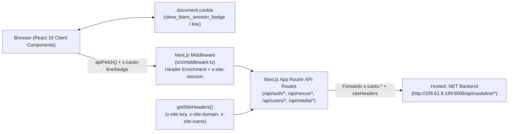

# QLEX_01 — ARCHITECTURE DISCOVERY

**Project:** QLEX (`QlexNursing` / package name `castoline`)  
**Audit Date:** 2026-11-16  
**Repository / Workspace:** `c:\Users\gitau\Documents\Qlex` (No `.git` directory present — active branch: `Unknown / Not a Git repository`)  
**App Version:** `0.1.0` (`package.json`) / `8.0.0` (`.env.local` `SKEW_LINE_APP_VERSION`)

---

## 1. Technology Stack

| Layer | Technology | Version / Evidence |
|---|---|---|
| **Framework** | Next.js (App Router + Turbopack) | `^15.5.19` (`package.json`) |
| **UI Library** | React / React DOM | `^18.3.1` (`package.json`) |
| **Language** | TypeScript (strict mode) | `^5` (`tsconfig.json`: `"strict": true`) |
| **Styling** | Tailwind CSS + PostCSS | `^4` (`@tailwindcss/postcss`) |
| **Icons** | `lucide-react`, `react-icons` | `^0.525.0`, `^5.7.0` |
| **Charts / Analytics** | `recharts`, `apexcharts`, `react-apexcharts` | `^3.10.1`, `^5.2.0`, `^1.7.0` |
| **Rich Text / HTML** | `html-react-parser`, `@tiptap/react`, `lexical` | `^6.1.5`, `^3.15.3`, `^0.39.0` |
| **Phone / Validation** | `react-phone-number-input`, `libphonenumber-js` | `^3.4.14`, `^1.12.10` |
| **HTTP Client** | Native `fetch` via `apiFetch` (`src/lib/api/api/api.ts`) | `axios` listed in `package.json` but unused (`src/lib/api/axios/axios.ts` commented out) |
| **Auth / Session** | Custom `x-casto-line` / `x-casto-badge` header + `document.cookie` | `next-auth` in `package.json` (`^4.24.11`), not active in `src/app/api/auth/` |
| **Hosted Backend** | External .NET (ASP.NET) REST API | `SKEW_LINE_ACTIVE_BACKEND=dotnet` -> `http://108.61.9.189:8008` |
| **Deployment / Domain** | Local Dev (`http://localhost:3000`); Prod domain unknown | `.env.local` (`SKEW_LINE_APP_DOMAIN=http://localhost:3000`) |
| **Automated Tests** | None present | 0 unit/integration/E2E test files in `src/` |

---

## 2. Project Directory Structure

```text
src/
├── middleware.ts                    # Request header enrichment + x-site-session cookie
├── app/
│   ├── layout.tsx                   # RootLayout (Theme, LeftSidebar, RightSidebar providers)
│   ├── (web)/                       # Public marketing, auth pages/modals, profile, heed, seek, subscription
│   ├── api/                         # Next.js BFF API routes (auth/*, media/*, nexus/*, seek, system/*, users/*)
│   ├── dashboards/                  # 6 exam-track dashboards (ati-teas, hesi-a2, lpn-nursing, nclex-pn, nclex-rn, rn-nursing) + shared/
│   └── web/
│       ├── (livexams)/              # Live exam engine across 6 tracks x 7 layouts (atlas, cascade, generic, glacial, orbit, pulse, zen)
│       └── (nexus)/                 # Public assessments & programs overview
├── components/
│   ├── common/                      # Shared UI, modals (seek, AccessReminderModals, useExamAccessGuard)
│   ├── dashboards/                  # Dashboard navbar, sidebars, elements
│   ├── panel/exam/tools/            # CustomMiniCalculator
│   └── web/                         # Marketing page sections
├── lib/
│   ├── api/api/api.ts               # apiFetch() & getBackendBaseUrl()
│   ├── config/                      # config.ts, siteHeaders.ts, siteLinks.ts
│   ├── contexts/                    # LiveStrataExamContext, useLiveExamActionContext, layout/theme contexts
│   ├── hooks/                       # Domain hooks (nexus/strata/*, nexus/subscription/*, users/*)
│   ├── services/                    # Client service wrappers (auth/*, nexus/strata/*, users/*, seek/*)
│   └── utils/                       # Session cookie helpers, pascalToCamelCase, SearchBar, PerPageSelect
└── styles/                          # Global & dashboard CSS
```

---

## 3. Architecture Diagram



---

## 4. Application Module Inventory

| Module | Classification | Evidence |
|---|---|---|
| **BFF API Proxy (`/api/*`)** | Fully implemented | `src/app/api/**` proxies to `http://108.61.9.189:8008/api/castoline/*` |
| **Registration & Login UI + Services** | Implemented (Runtime Blocked) | `src/app/(web)/auth/*`, `loginService.ts`, `registerService.ts` (see `QLEX_04`/`QLEX_05` for `pin_confirmation` bug & browser mount issue) |
| **Session & Identity** | Partially implemented / Insecure | Client-side `document.cookie` tokens; `/api/auth/session` returns 500 when unauthenticated |
| **Learner Dashboards (6 tracks)** | Duplicated / Implemented | `src/app/dashboards/{ati-teas,hesi-a2,lpn-nursing,nclex-pn,nclex-rn,rn-nursing}/` |
| **Exam Engine (38 Question Types)** | Implemented (Untested Live) | `src/app/web/(livexams)/partials/dispatcher/QuestionTypes.tsx` + 19 standalone + `CaseBasedDynamics.tsx` |
| **Results & Reports** | Implemented (Untested Live) | `results/distinct/page.tsx`, `reports/{absolute,distinct,relative}/page.tsx` |
| **Performance Analytics** | Implemented (Client-Aggregated) | `progress/absolute/page.tsx` (`recharts`), `reports/absolute/summary/Comparison.tsx` |
| **Study & Learning Hierarchy** | Partially implemented | `vista/learning/{programs,courses,subjects}/`, `(web)/pages/notes`, `resources` |
| **Session Control Service** | Disconnected | `src/lib/services/users/session/sessionService.ts` calls `/api/users/session` (route is `/api/users/controls/session`) |
