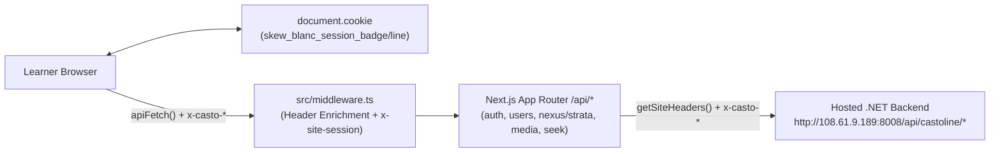

# QLEX — MASTER COMPREHENSIVE APPLICATION AUDIT REPORT

**Project:** QLEX (`QlexNursing` / `castoline`)  
**Audit Date:** 2026-11-16  
**Workspace:** `c:\Users\gitau\Documents\Qlex`  
**Hosted Backend:** `http://108.61.9.189:8008` (`SKEW_LINE_ACTIVE_BACKEND=dotnet`)  
**Audit Mode:** Read-Only Investigation & Controlled Functional Testing (No Application Code Modified)

---

## 1. Executive Summary

QLEX is a **Next.js 15.5.19 (App Router, React 18, TypeScript strict, Tailwind CSS v4)** nursing examination and learning platform that operates as a **Backend-for-Frontend (BFF) proxy** to an external **.NET (`castoline`) REST API** at `http://108.61.9.189:8008`.

### Key Findings
- **Build & Static Quality:** `npx tsc --noEmit` (0 errors) and `npm run lint` (0 warnings/errors) both **PASS**. However, **0 automated unit, integration, or E2E tests** exist in the repository.
- **Live Functional Verification (`http://localhost:3000`):**
  - The hosted backend is reachable, but returns **0 exams** (`skewTotal: 0`) and **0 programs** (`data: []`) for `QlexNursing`.
  - Unauthenticated requests to `GET /api/auth/session` and `GET /api/nexus/strata/assessment/result?fetchtype=relative` return **HTTP 500**.
  - Empty `programs` causes the dashboard to fire `exam?fetchtype=nominal&identifier=` with an empty identifier (**HTTP 400**).
  - Because auth forms failed to mount interactively in the browser session and 0 exams exist on the backend, live end-to-end execution of registration, login, exam taking, submission, grading, and answer review is **BLOCKED / UNVERIFIED**.
- **Critical Security & Data Integrity Findings (Code-Verified):**
  - **P0:** Auth tokens (`skew_blanc_session_line`, `skew_blanc_session_badge`) are stored in non-`HttpOnly` `document.cookie`, paired with unsanitized `dangerouslySetInnerHTML` in question renderers.
  - **P0:** `StrataSessionQuestionFull` models `questionCorrectAnswers` and `isCorrect` on the live exam payload.
  - **P0:** `reports/absolute/page.tsx` fetches `fetchtype=absolute` (`othersAttempts`) to compute peer comparisons client-side.
  - **P1:** Plaintext passwords/PINs and session tokens are logged to server/browser consoles in auth routes and `registerService.ts`; `pin_confirmation` is dropped in `register/route.ts`; `useExamAccessGuard.tsx` links to non-existent `/auth/verify-email` and checks the wrong user field (`emailVerified` instead of `emailConfirmed`); `handleConfirmedSubmit` does not flush pending 800ms debounced answers.

**Production Readiness Assessment:** **NOT READY FOR PRODUCTION** until P0/P1 security, session-handling, autosave-flush, and hosted-backend seeding/500 issues are resolved and verified end-to-end.

---

## 2. Architecture Overview

---

## 3. Consolidated Test Coverage & Acceptance Matrix

| Module | Acceptance Criterion | Status | Evidence |
|---|---|---|---|
| Registration | Account successfully created | **UNVERIFIED / BLOCKED** | `/auth/register` form did not mount in browser; `pin_confirmation` bug in `register/route.ts` |
| Login | Correct authentication | **UNVERIFIED / BLOCKED** | `/auth/login` form did not mount in browser; plaintext password logged in `login/route.ts` |
| Session | Secure session restoration | **FAIL** | `GET /api/auth/session` returns HTTP 500 unauthenticated; tokens are non-`HttpOnly` |
| Logout | Proper session termination | **UNVERIFIED** | `dynamicLogoutService` calls `/api/auth/logout` and clears cookies; untested live |
| Profile | Correct retrieval and updates | **UNVERIFIED** | `GET /api/users/user?fetchtype=current` returns 401 unauth; update untested live |
| Dashboard | Accurate learner-specific information | **PARTIAL** | Uses real backend hooks (no mocks), but triggers HTTP 400 (`nominal`) & HTTP 500 (`result`) on guest load |
| Catalogue | Actual available examinations | **FAIL (Empty)** | `GET /api/nexus/strata/assessment/exam?fetchtype=absolute` returns `200 OK` with `items: [], skewTotal: 0` |
| Exam details | Correct examination information | **UNVERIFIED** | Blocked by 0 exams in backend |
| Initiation | Valid persisted attempt | **UNVERIFIED** | Code verified (`list/live`); live test blocked |
| Questions | Correct question rendering | **PARTIAL** | 38 types implemented in `QuestionTypes.tsx`; uses unsanitized `dangerouslySetInnerHTML` |
| Question types | Supported interactions work | **UNVERIFIED** | 19 standalone + 19 case-based components exist; untested live |
| Navigation | Reliable question navigation | **UNVERIFIED** | `QuestionHeader` + `QuestionActionNavigator` implemented; untested live |
| Answers | Correct answer state | **PARTIAL** | `useReducer` store in `LiveExamActionProvider`; untested live |
| Autosave | Reliable answer persistence | **PARTIAL** | 800ms debounce + 8x retry implemented; not flushed on submit |
| Timer | Accurate examination timing | **PARTIAL** | 1s tick + 2m residual sync; `beforeunload` uses regular `fetch` instead of `sendBeacon` |
| Submission | Correct attempt finalization | **UNVERIFIED** | `ActionExamSubmit` implemented; unflushed debounce risk |
| Grading | Authoritative score calculation | **UNVERIFIED** | Server-side on hosted .NET backend; untested live |
| Results | Correct persisted results | **FAIL / UNVERIFIED** | `result?fetchtype=relative` returns HTTP 500 unauthenticated |
| Review | Actual submitted-answer reconciliation | **PARTIAL** | `WrongQuestionCard` omits correct answer/rationale; full review uses `mode=review` |
| History | Persistent examination records | **UNVERIFIED** | `reports/relative/page.tsx` implemented; untested live |
| Analytics | Accurate learner performance | **PARTIAL** | Recharts/gauges implemented client-side; `reports/absolute` peer comparison poses P0 privacy risk |
| Study modules | Verified learning functionality | **PARTIAL** | Hierarchy + DIY exam builder implemented; `programs` returns `[]`; no flashcards |
| Security | Correct authorization | **FAIL** | Non-`HttpOnly` cookies, no middleware auth, broken `useExamAccessGuard`, credential logging |
| Persistence | Data survives new sessions | **UNVERIFIED** | Blocked by auth/empty backend |
| Error handling | Recoverable failures | **PARTIAL** | Retry logic in exam engine; BFF leaks 500s on unauthenticated `/session` & `/result` |
| Performance | Acceptable responsiveness | **PARTIAL** | `tsc` & `lint` pass; 6x dashboard & 7x exam layout code duplication |
| Accessibility | Core workflows accessible | **PARTIAL** | Progress bar slider lacks keyboard/ARIA `role="slider"` |

---

## 4. Explicit Answers to the 40 Audit Questions

### Architecture
1. **What is the actual QLEX technology stack?** Next.js `15.5.19` (App Router + Turbopack), React `18.3.1`, TypeScript `5`, Tailwind CSS `v4`, `recharts`/`apexcharts`, `lucide-react`/`react-icons`, native `fetch`. (**Verified** — `package.json`)
2. **How is the frontend structured?** Route groups `(web)` (marketing/auth/profile), `dashboards/{6 tracks}` (learner portal), `web/(livexams)/{6 tracks}/vista/exam/(layout)/{7 layouts}` (exam engine), `api/*` (BFF), `lib/{api,config,contexts,hooks,services,utils}`. (**Verified**)
3. **How does the frontend communicate with the hosted backend?** Exclusively via Next.js `/api/*` BFF routes (`apiFetch` blocks direct `http(s)://` calls) which forward `getSiteHeaders()` and `x-casto-line`/`x-casto-badge` to `http://108.61.9.189:8008/api/castoline/*`. (**Verified**)
4. **What is the authoritative data source?** The hosted .NET backend (`http://108.61.9.189:8008`). (**Verified**)
5. **What is the authentication architecture?** Custom token/badge headers (`x-casto-line`, `x-casto-badge`) stored client-side in `document.cookie` (`skew_blanc_session_line`, `skew_blanc_session_badge`), plus social OAuth redirects. `next-auth` is installed but unused. (**Verified**)

### Registration and Authentication
6. **Does registration work?** **UNVERIFIED / BLOCKED** — Form did not mount interactively in browser test; `register/route.ts` drops `pin_confirmation` due to camelCase mismatch.
7. **Does login work?** **UNVERIFIED / BLOCKED** — Form did not mount interactively in browser test; `login/route.ts` logs plaintext passwords.
8. **Does session restoration work?** **FAIL (Unauthenticated)** — `GET /api/auth/session` returns HTTP 500 `{"logged_in":false}`; authenticated restoration is **UNVERIFIED**.
9. **Does logout properly invalidate the session?** **UNVERIFIED** — Code calls `POST /api/auth/logout` and clears cookies in `finally`; untested live.
10. **Are protected routes actually protected?** **FAIL (Server-side)** — `src/middleware.ts` enforces no auth/RBAC; protection is client-side UI gating only.

### Learner Experience
11. **Does profile retrieval work?** **UNVERIFIED** — `GET /api/users/user?fetchtype=current` returns 401 unauthenticated; authenticated retrieval untested.
12. **Do profile updates persist?** **UNVERIFIED** — `updateCurrentUserProfile` targets `/api/auth/support/account`; untested live.
13. **Does the dashboard use real learner data?** **YES (in code)** — Uses `useCurrentSystemUser`, `useRelativeStrataPrograms`, `useNominalStrataExams`, `useRelativeStrataAssessmentResults` (no mocked data). (**Verified**)
14. **Are all dashboard metrics accurate?** **UNVERIFIED** — Metrics are computed client-side from paginated results (`useMemo`); if `perPage < total`, aggregates reflect only the fetched page.

### Examinations
15. **Are examinations retrieved from the backend?** **YES**, via `GET /api/nexus/strata/assessment/exam`, which returned `200 OK` with `items: [], skewTotal: 0`. (**Verified live**)
16. **Does examination initiation create a valid attempt?** **UNVERIFIED** — Handled by backend `exams/list/live`; untested live due to 0 exams.
17. **Are questions retrieved correctly?** **UNVERIFIED** — Modeled in `StrataExamSessionResponse.sections[].questions`; untested live.
18. **Are all supported question types functional?** **UNVERIFIED** — 38 types (19 standalone + 19 case-based) are implemented in `QuestionTypes.tsx`; untested live.
19. **Are answers persisted?** **UNVERIFIED** — `ExamAnswers` upsert route exists; untested live.
20. **Does autosave work?** **PARTIAL (Code)** — 800ms debounce + 8x retry implemented in `LiveExamActionProvider`, but not flushed on submit; untested live.
21. **Is the timer reliable?** **PARTIAL (Code)** — 1s client tick + 2m `residualDuration` sync; `beforeunload` uses regular `fetch` (can be aborted on close).
22. **Can interrupted examinations be recovered?** **UNVERIFIED** — Code restores `savedUserAnswer`, `residualDuration`, and `sessionStorage` question index; untested live.
23. **Does submission work?** **UNVERIFIED** — `ActionExamSubmit` implemented; untested live.
24. **Is the attempt correctly finalized?** **UNVERIFIED** — Backend-owned; untested live.

### Results and Learning
25. **Does authoritative grading work?** **UNVERIFIED** — Backend-owned; untested live.
26. **Are results accurate?** **UNVERIFIED** — `result?fetchtype=relative` returned HTTP 500 unauthenticated.
27. **Does answer review show the actual submitted answers?** **UNVERIFIED** — `WrongQuestionCard` parses `userAnswerData`; full review uses `mode=review`.
28. **Are explanations and rationales correctly associated?** **UNVERIFIED** — `WrongQuestionCard` omits explanations/correct answers; `mode=review` relies on `questionCorrectAnswers`.
29. **Does examination history persist?** **UNVERIFIED** — `reports/relative/page.tsx` reads `result?fetchtype=relative`; untested live.
30. **Are performance analytics based on real records?** **YES (in code)** — Aggregated client-side from `StrataExamResultItem[]`.
31. **Do study and revision features work?** **PARTIAL** — Learning hierarchy & DIY exam builder exist, but `programs` returned `data: []`; no flashcards exist.

### Security and Readiness
32. **Is learner data properly isolated?** **FAIL / AT RISK (P0)** — `reports/absolute/page.tsx` fetches `fetchtype=absolute` (`othersAttempts`) to compute peer comparison client-side.
33. **Are permissions enforced?** **FAIL (Client-only)** — Middleware has no auth/RBAC; `useExamAccessGuard` has broken `emailVerified` check and broken `/auth/verify-email` link.
34. **Are credentials protected?** **FAIL (P1)** — Plaintext passwords/PINs logged in `login/route.ts`, `register/route.ts`, `registerService.ts`; tokens logged in `session/route.ts`, `users/user/route.ts`.
35. **Are there security vulnerabilities?** **YES** — See `QLEX_20_SECURITY_AND_AUTHORIZATION_AUDIT.md` (3 P0, 3 P1, 2 P2).
36. **Are there data persistence risks?** **YES** — Unflushed 800ms debounce on submit; non-`keepalive` `beforeunload` timer sync.
37. **Are there backend integration failures?** **YES** — HTTP 500 on `/api/auth/session` and `/api/nexus/strata/assessment/result?fetchtype=relative` when unauthenticated; `sessionService.ts` targets wrong URL; 0 exams/programs seeded for `QlexNursing`.
38. **What features are incomplete?** Flashcards/spaced repetition, inline explanations in `WrongQuestionCard`, server-side middleware auth, `sessionService` route alignment, automated tests.
39. **Which existing features must not be modified?** The BFF `apiFetch` pattern (`src/lib/api/api/api.ts`), `getSiteHeaders()` contract (`src/lib/config/siteHeaders.ts`), the 38-type `QuestionTypes` registry, and server-authoritative grading.
40. **Is QLEX ready for production acceptance?** **NO** — Blocked by P0/P1 security defects, unauthenticated 500s, empty hosted backend data for `QlexNursing`, and unverified E2E learner flows.

---

## 5. Complete Deliverable Index (`audit_reports/`)

All 26 audit documents have been generated in `c:\Users\gitau\Documents\Qlex\audit_reports\`:
- `QLEX_MASTER_AUDIT_REPORT.md`
- `QLEX_01_ARCHITECTURE_DISCOVERY.md` through `QLEX_25_REMEDIATION_ROADMAP.md`
